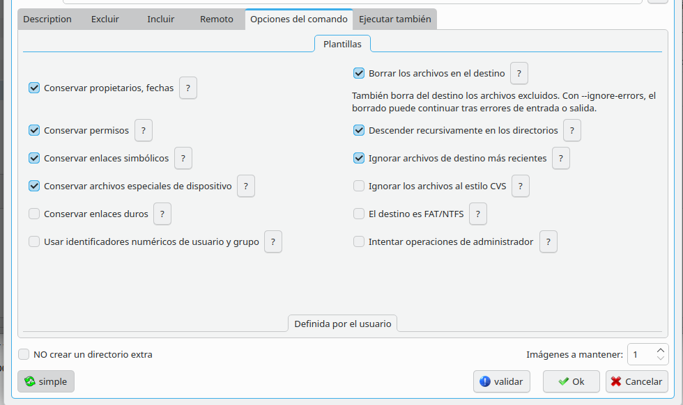

# luckyBackup · Community edition

[Español](README-luckybackup-resolute.md) · **English**

This community edition of luckyBackup 0.5.0 improves the Spanish help and explains how to schedule backups on Wayland. The packages in this release are built for **Kubuntu 26.04 LTS (Resolute), amd64**, using Ubuntu's 0.5.0-7build3 packaging as the base.

## Schedule backups on Wayland

Open **Schedule**, add or edit a scheduled task, and select **Console mode (recommended on Wayland)**. Save the task and apply the schedule from luckyBackup to update cron.

Console mode lets cron run the backup without opening a window or relying on `DISPLAY=:0`. The output goes to the scheduled task's log. When you view the current crontab, the entry for that task should contain `luckybackup -c --no-questions`. If you enabled **Skip critical**, the entry also includes `--skip-critical`.

Updating the package keeps your saved schedules. Enable console mode on each task you want to run this way.


*Scheduling dialog in Spanish.*

## Help for backup options

Open **Task properties → Command Options → Templates**. Hover over or click the **?** buttons to read each explanation. A note below **Delete files on the destination** explains how exclusions and `--ignore-errors` affect deletions. When that option is enabled, rsync can continue deleting destination files after input/output errors. [rsync manual](https://rsync.samba.org/ftp/rsync/rsync.1.html)

This edition uses the existing luckyBackup backup engine. A graphical picker for restoring individual files and folders is planned separately.



*Command options in Spanish.*

## Window placement in Plasma

If the main window opens in an inconvenient position, create a Plasma window rule for luckyBackup and choose **Remember** for **Size** and **Position**. Tested on Plasma X11. On Wayland, placement depends on KWin and the rule applied.

## Install the test build

1. Download the matching `luckybackup` and `luckybackup-data` packages from the release assets.
2. Back up `~/.luckyBackup` and keep the original Ubuntu packages available if you want to be able to roll back.
3. Close luckyBackup. Open a terminal in the folder containing only the two test packages and run:

   ```bash
   sudo apt install ./luckybackup_0.5.0-7+resolute2_amd64.deb ./luckybackup-data_0.5.0-7+resolute2_all.deb
   ```

4. Open luckyBackup and inspect **Templates** and **Schedule**. You can review the text without running a backup or applying schedule changes to cron.

## Roll back to the Ubuntu packages

Close luckyBackup. Open a terminal in the folder containing the two original 0.5.0-7build3 packages and run:

```bash
sudo apt install --allow-downgrades ./luckybackup_0.5.0-7build3_amd64.deb ./luckybackup-data_0.5.0-7build3_all.deb
```

## Source code and build process

The repository contains the changes and the GitHub Actions workflow used to build both packages. The workflow applies the patch to the 0.5.0-7build3 source and packaging, then regenerates the Spanish Qt translation catalog. Before uploading the test packages, it checks that `luckybackup-data` contains the newly generated catalog.

If you report an issue, include the luckyBackup version, your distribution, whether you use Wayland or X11, and the steps to reproduce it. Remove personal details and paths from any screenshots or logs you share.

## Credits and license

luckyBackup was created by **Loukas Avgeriou**. Copyright © 2008–2018 Loukas Avgeriou. This community edition uses Ubuntu's packaging and retains the original project's copyright notices and GNU General Public License, version 3. [Original project on SourceForge](https://sourceforge.net/projects/luckybackup/) · [GPLv3 license](https://www.gnu.org/licenses/gpl-3.0.html)

If you'd like to support WonderSkydive's work on this community edition, you can [make an optional contribution via PayPal](https://www.paypal.com/ncp/payment/KWEHYT4HDTARE).
